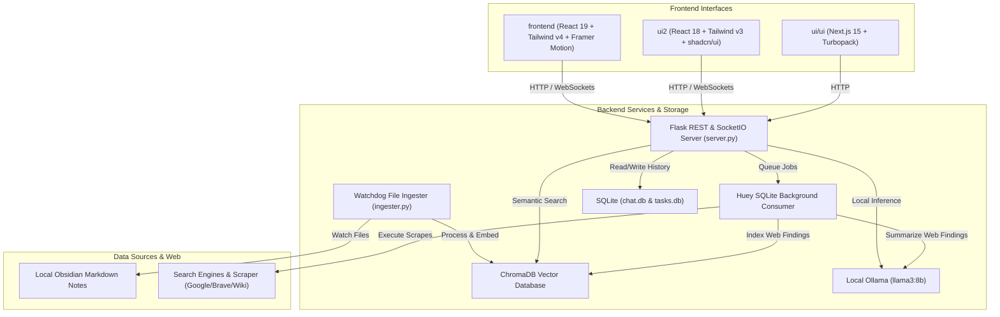

# Luminescent Research: DaVinci 2.0 AI System

[](https://www.python.org/)
[](https://react.dev/)
[](https://flask.palletsprojects.com/)
[](https://www.trychroma.com/)
[](https://www.sqlite.org/)
[](https://huey.readthedocs.io/)

A state-of-the-art personal knowledge assistant and autonomous research system. It integrates semantic search over private notes (Obsidian vaults), multi-format document analysis, and automatic deep web discovery directly into a consolidated local workspace.

---

## 🧠 System Explanation & How It Works

This project is built around the concept of **Local-First Knowledge Retrieval-Augmented Generation (RAG)**. It is designed to act as an offline brain that processes, structures, and expands your personal notes and uploaded documents without leaking data to external cloud LLM providers.

Here is a detailed breakdown of how the different components operate under the hood:

### 1. The Real-Time Document Ingestion Engine (`ingester.py`)

Instead of manually importing notes, the system monitors your Obsidian vault or any local directory of markdown files.

- **Watchdog Listener**: When you create, edit, or delete `.md` files, a background event listener triggers immediately.
- **Wiki-link Sanitizer**: Before indexing, a preprocessing layer cleans up Obsidian-specific syntax (converting `[[Page|Alias]]` to normal text, stripping out embedded images like `![[image.png]]`).
- **Vector Chunking**: Text is split into overlapping chunks of 500 characters using `RecursiveCharacterTextSplitter`.
- **Embeddings**: Each chunk is transformed into a 384-dimensional vector using the local `all-MiniLM-L6-v2` transformer model and stored in ChromaDB under the `obsidian_notes` collection.

### 2. Strict Context-Bounded Chat (`server.py` & `tasks.py`)

To prevent the hallucinations common in generic LLMs, the chat module uses a strict Retrieval-Augmented Generation (RAG) loop:

- **Semantic Retrieval**: Your query is embedded and compared against notes in ChromaDB using L2 distance scoring.
- **Distance Filtering**: Only chunks with a distance score below `1.5` to `1.7` (highly relevant) are selected.
- **Strict RAG Prompting**: The local Llama 3 model is fed the retrieved chunks alongside rigorous guidelines: _If the answer cannot be found in the context, explicitly deny knowledge in exactly one sentence._ This ensures the assistant only speaks using the facts present in your notes.
- **Chat History**: Every query and AI response is indexed in a local SQLite database (`chat.db`) to enable multi-turn conversation memory.

### 3. Smart Intent-Routed Web Research (`server/research/`)

When you request "Web Research" on a topic, the system launches a multi-stage autonomous scraping pipeline:

- **Intent Routing**: A classifier model determines if your query is **Factual/General Knowledge** (routes to Wikipedia API) or **Technical/Code-Related** (routes to Google/Brave search).
- **Resilient Scraper**: It fetches up to the top 6 links, visits each page, and strips out boilerplate elements (navigation bar, footers, script files, stylesheets) using BeautifulSoup.
- **Local Summarizer**: The raw text of the pages is summarized into markdown-formatted structured guides using Llama 3.
- **Auto-Indexing**: The summarized findings are automatically chunked, embedded, and saved back into ChromaDB. The next time you ask the chat assistant about that topic, the scraped web knowledge is retrieved as a source!

### 4. Interactive Document Analyzer

When a new document (PDF, DOCX, TXT) is uploaded:

- Its text is extracted, chunked (1,000 characters), embedded, and indexed inside a dedicated `analyzer_docs` collection in ChromaDB.
- The metadata (size, upload timestamp, original name) is saved to the SQLite database.
- In the frontend, a dual-pane layout displays a preview of the document side-by-side with a conversational sidebar dedicated specifically to querying that document's content.

---

## 🏗️ Architecture Overview

The system is designed with a decoupled architecture containing a robust Python backend service (providing RAG and background task queues), a watchdog-based notes ingester, and three choices of frontend client interfaces.



---

## 🚀 Key Features

- 💬 **Research Chat**: Query local knowledge bases semantically. The prompt routing prioritizes contextual answers directly from your private files using strict relevance distance thresholds.
- 📂 **Real-time Note Indexing**: Continuously monitors a local markdown directory (like an Obsidian vault) using file system watchers. Automatically cleans Wikipedia links and media embeds, chunks the text, and stores them in ChromaDB.
- 📄 **Document Analyzer**: Upload `PDF`, `DOCX`, or `TXT` documents. Extracts content, chunks/indexes the text in a dedicated Chroma collection, and permits interactive messaging and query referencing against specific documents.
- 🌐 **Autonomous Web Discovery**: Classifies search intent (factual vs. technical) using the local LLM. Fetches top matches from Google, Brave, and Wikipedia, scrapes and strips page contents, and generates structured summarizations that are auto-injected back into your primary Chroma database.
- ⚡ **Persistent Background Tasks**: Employs Huey for SQLite-backed queuing of intensive research runs and workflows, preventing server blocking.

---

## 💻 Tech Stack

### Backend & AI Pipelines

- **API Framework**: Flask, Flask-CORS, Flask-SocketIO (for live websocket logs/status updates).
- **Database**: SQLite (`chat.db` for conversations/documents; `tasks.db` for the background worker queue).
- **Vector Engine**: ChromaDB (with local `all-MiniLM-L6-v2` embeddings via SentenceTransformers).
- **Inference Engine**: Ollama (running the `llama3:8b` model locally at port `11434`).
- **File Observers**: Python Watchdog.
- **Document Parsers**: PyPDF2, python-docx, Beautiful Soup 4.

### Frontend Options

1.  **`frontend/`**: The primary premium monolithic app. Built with React 19, Vite 8, Tailwind CSS v4, Lucide icons, Framer Motion animations, Socket.io, and Zustand.
2.  **`ui2/`**: A highly modular layout generated with Lovable. Built with React 18, Vite 5, Tailwind CSS v3, and shadcn/ui components.
3.  **`ui/ui/`**: A Next.js 15 application supporting Turbopack compilation.

---

## 🛠️ Setup & Configuration

### Prerequisites

- [Python 3.9+](https://www.python.org/downloads/)
- [Node.js (v18+) & NPM / Bun](https://nodejs.org/)
- [Ollama](https://ollama.com/)

---

### Step 1: Initialize the Local LLM (Ollama)

Install Ollama and fetch the required model:

```bash
# Start the Ollama service, then run:
ollama pull llama3:8b
```

---

### Step 2: Configure Environment Paths

Before running the system, edit the configuration paths in the codebase to point to your directories.

You need to update:

1.  **`server/server.py`** (Lines 35-36)
2.  **`server/tasks.py`** (Line 22)
3.  **`ingester/ingester.py`** (Lines 18-19)

Example:

```python
# Absolute path to your Obsidian notes/markdown folder
VAULT_PATH = r"C:\Users\<Name>\Documents\MyNotes\Rag"

# Path where ChromaDB persistent database will be created/stored
CHROMA_PATH = r"C:\Users\<Name>\Development\Davinci-2.0\chroma_db"
```

---

### Step 3: Backend Installation

Create a Python virtual environment and install dependencies:

```bash
cd server

# Create and activate environment
python -m venv venv
# On Windows (PowerShell):
.\venv\Scripts\Activate.ps1
# On Unix:
source venv/bin/activate

# Install required packages
pip install -r requirements.txt
```

---

### Step 4: Index Existing Notes

To run the initial notes ingestion and start watching your Obsidian vault for modifications:

```bash
# From the root directory:
python ingester/ingester.py
```

---

## 🚀 Running the Applications

### 1. Starting the Backend Server and Background Task Consumer

The server folder includes an orchestration script (`run_system.py`) that boots both the Flask application and the Huey task consumer.

```bash
# Activate your python virtualenv first, then run:
python server/run_system.py
```

- **API Server Address**: `http://localhost:5000`
- **WebSocket Engine**: `ws://localhost:5000`
- **Background worker**: SQLite-based Huey thread running tasks in the background.

_Alternatively, during development you can run the root-level hot-reloader watcher to automatically restart Flask when python code changes:_

```bash
python run_server.py
```

---

### 2. Starting the Frontends

Choose the frontend interface you prefer and start its dev server.

#### Option A: Monolithic UI (Recommended)

```bash
cd frontend
npm install
npm run dev
```

Open [http://localhost:5173](http://localhost:5173) in your browser.

#### Option B: Modular UI

```bash
cd ui2
npm install
npm run dev
```

#### Option C: NextJS UI

```bash
cd ui/ui
npm install
npm run dev
```

Open [http://localhost:3000](http://localhost:3000) in your browser.

---

## 🧪 Debugging & Diagnostics

The root workspace includes diagnostic scripts to check indexing status and vector similarity results without running the frontend:

- **ChromaDB Inspector (`debug_chroma.py`)**: Lists all documents currently indexed in ChromaDB and counts total embeddings.
  ```bash
  python debug_chroma.py
  ```
- **Retrieval Diagnostics (`debug_retrieval.py`)**: Runs sample queries against the index and writes outputs to `retrieval_debug.log` to test vector similarity and confidence margins.
  ```bash
  python debug_retrieval.py
  ```

---

## 🛡️ Troubleshooting

1.  **Database / Huey Queue Locking issues**:
    If a process crashes and leaves the queue locked, delete the lock file in the backend queue folder:
    ```bash
    rm server/queue/queue.lock
    ```
2.  **Ollama Connection Errors**:
    Ensure the Ollama application is active in the background. Run `curl http://localhost:11434` to verify if the server is responsive.
3.  **Flask Port Conflicts**:
    If port `5000` is already in use, you can free the port (on Unix: `lsof -ti:5000 | xargs kill -9`, on Windows: use Resource Monitor or taskkill).
